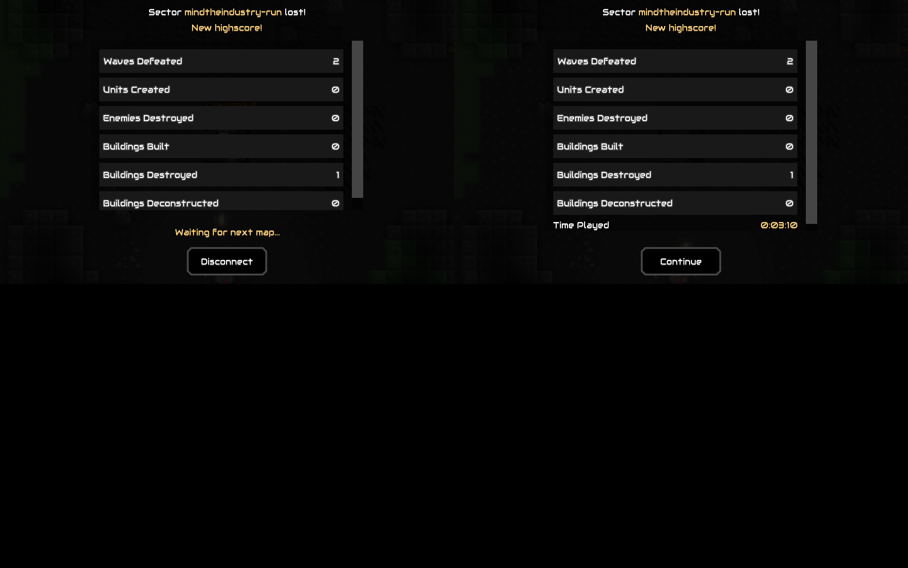

# tools/lan — local two-instance LAN validation stack

Runs the vanilla desktop game **twice on this machine** (official non-Steam
desktop jar, one-time download cached in `tools/lan/.cache/`; mod jar installed
per instance) so a LAN game can be created locally, and gives the agent UI
access: screenshots rendered as ASCII grids (`read_file` cannot decode PNGs)
plus synthetic mouse/keyboard input (python-xlib XTEST).

Headless tests (`mise exec -- ./gradlew test`) remain the primary validation for
game mechanics; this stack exists for what headless cannot cover: the `ui/`
layer and real two-client networking. See AGENTS.md.

## Commands (mise tasks)

| command | effect |
|---|---|
| `mise lan:up` | build mod jar if stale, boot instances p1 + p2 side by side, pin windows |
| `mise lan:status` | processes, windows, log tails |
| `mise lan:shot <p1\|p2\|root> <name>` | screenshot into `tools/lan/shots/<name>.png` (p1/p2 composited with popups) |
| `mise lan:ascii <name>` | render `shots/<name>.png` as ASCII (`LAN_COLS=160` to widen) |
| `mise lan:click <p1\|p2> <x> <y>` | left click at window-relative coords |
| `mise lan:rclick <p1\|p2> <x> <y>` | right click |
| `mise lan:key <p1\|p2> <keysym>` | press a key (`Return`, `Escape`, `Tab`, ...) |
| `mise lan:type <p1\|p2> <text>` | type ASCII text |
| `mise lan:probe <p1\|p2> <cmd>` | devtools probe command (dump / tapc x y / play <p> / host / join <ip> / ...) — see below |
| `mise lan:scene <p1\|p2> [jq]` | print the instance's last scene dump (`run/<p>/mti-scene.json`) |
| `mise lan:proof <p1\|p2\|root> <name> [note]` | capture a screenshot into **committed** PR evidence `tools/lan/evidence/<name>.png` (+ README entry) |
| `mise lan:down` | stop both instances (logs/shots kept in `tools/lan/run|shots`) |

## How it works

- Game jar: the official non-Steam desktop release for the pinned
  `mindustryVersion` (`build.gradle.kts`), downloaded once into
  `tools/lan/.cache/` (see the error message of `mise lan:up` for the exact
  command). The Gradle cache only holds the core jar (no `DesktopLauncher`).
- Each instance gets its own data dir via `MINDUSTRY_DATA_DIR`
  (`tools/lan/run/p1`, `p2`) with the mod jar copied into `mods/`, so settings,
  saves and the `last_log.txt` are per-instance. Game logs: `run/p*/game.log`.
- Windows are pinned with wmctrl: p1 at x=0, p2 at x=960 (960x600 each), ids
  recorded in `run/p*.win`.
- Networking: p1 hosts (in-game pause menu -> Host server), p2 joins via the
  Join dialog (LAN discovery or `127.0.0.1`) — both on `LAN_DISPLAY` (defaults
  to `$DISPLAY`; set `LAN_DISPLAY=:99` to use a private Xvfb). Default Mindustry
  port 6567 is only bound by the host, so two local clients do not conflict.
- Screenshots: `capture.py` composites the game window with overlapping popup
  windows via Xlib `get_image` (this X server does not paint child windows into
  the root pixmap, so `import -window root` misses them); `ascii.sh` renders
  the PNG as a luminance grid for the agent.
- Input: `input.py` activates the target window (`wmctrl -i -a`), then sends
  XTEST events at window-relative coordinates.
- Requirements: `java` (mise), ImageMagick (`import`, `convert`, `identify`),
  `wmctrl`, `python3` with `python-xlib` + Pillow, an X server with XTEST.

## Typical agent flow

```sh
mise lan:up                      # wait for boot (watch mise lan:status)
mise lan:shot p1 menu && mise lan:ascii menu     # calibrate menu coordinates
mise lan:click p1 211 125        # ... navigate menus on p1 (host)
mise lan:click p2 ...            # ... join 127.0.0.1 on p2
mise lan:shot p1 ingame && mise lan:ascii ingame # verify HUD / reward box
mise lan:down
```

With the devtools probe (recommended — no pixel-reading needed):

```sh
mise lan:up
mise lan:probe p1 dump; sleep 2; mise lan:scene p1 \
  '[.elements[] | select(.cls=="TextButton" and .w>=200)] | map({text, cx: (.wx+.w/2), cy: (.wy+.h/2)}) | unique_by(.text)'
mise lan:probe p1 "tapc 211 125"          # click Play (window coords = dump wx/wy)
mise lan:probe p1 "play mindtheindustry-run"   # launch the MTI run map directly
mise lan:probe p1 "host"                  # p1: net.host(6567)
mise lan:probe p2 "join 127.0.0.1"        # p2: net.connect (JoinDialog sequence)
mise lan:shot p1 ingame && mise lan:ascii ingame
mise lan:down
```

## Devtools probe (tools/lan/devtools)

A dev-only mod jar (built by `devtools/build.sh` with plain `javac` against the
game jar, copied into each instance's `mods/` by `lan:up`; **never** part of
the shipped mod). It watches `run/<p>/mti-probe` in the instance's data dir and
answers in `run/<p>/mti-scene.json` (~1s latency; the game renders slowly under
llvmpipe, so sleep a few seconds). Commands (`mise lan:probe <p1|p2> <cmd>`):

| command | effect |
|---|---|
| `dump` | write the scene graph: every visible on-screen element with `cls`, `name`, `text`, stage `x/y/w/h` and window-relative `wx/wy` (y-down, same as screenshots and `input.py`) |
| `highlight <text>` / `clear` | blink matching elements red/white (visual confirmation in shots) |
| `tapc <x> <y>` / `rtapc <x> <y>` | click at window-relative coords (scene-level input, works even where XTEST pointer buttons don't — see gotchas) |
| `tap <x> <y>` | same but stage y-up coords |
| `key <KeyCode>` | scene-level key event (e.g. `escape`) — note: game keybinds need real XTEST keys (`lan:key`) |
| `hit <x> <y>` | report the element at window-relative coords |
| `play <presetOrPlanet>` | `control.playSector(...)` — launch a map directly, bypassing the 3D planet globe (impractical to click on llvmpipe) |
| `host` | `net.host(port)` + HostEvent (same as HostDialog) |
| `join <ip> [port]` | full JoinDialog connect sequence to a LAN server |
| `setname <name>` | set player name (needed: empty name → kicked `nameEmpty`) |
| `state` / `presets` / `root` | debug: current sector / sector presets / scene root children |

`mise lan:scene <p1|p2> [jq-filter]` pretty-prints the last dump (jq).

## Proof screenshots for PRs

`mise lan:proof <target> <name> <note>` captures a real PNG into the
**committed** `tools/lan/evidence/` directory (with a markdown entry in its
README) and prints a ready-to-paste embed line, so a PR body shows actual
proof. In PR bodies use the **absolute raw URL** form — GitHub resolves
relative links in a PR body against the *base* branch, where the evidence
doesn't exist yet (broken images); absolute links work from the head branch
immediately, and the relative form starts working once merged:

```md

```

Runtime screenshots stay gitignored in `tools/lan/shots/`; only curated
proof shots go into `evidence/` — tracked via **Git LFS** (see `.gitattributes`;
run `git lfs install` once per machine). Combine with `lan:probe <p> "highlight <text>"`
to make the element under test blink in the proof shot.

## Gotchas (verified the hard way)

- **LD_LIBRARY_PATH pollution**: the agent shell exports an
  `LD_LIBRARY_PATH` (editor runtime) whose libstdc++ breaks libGL and
  ImageMagick/libicu — the game dies with `Couldn't find matching GLX visual`
  and `identify`/`convert` fail. All stack scripts `unset LD_LIBRARY_PATH`
  (common.sh) and the input tasks use `env -u LD_LIBRARY_PATH`; do the same for
  any direct shell calls. The game is launched with `LIBGL_ALWAYS_SOFTWARE=1`
  (llvmpipe on the private Xvfb).
- **XTEST pointer buttons don't reach the game on the private Xvfb** (keyboard
  does). Use `lan:probe <p> "tapc x y"` for clicks there; `lan:click` (XTEST) is
  for real displays. Verify delivery with `lan:probe <p> "hit x y"`.
- **Boot races**: after `lan:down`, the X socket may linger — `up.sh` removes a
  stale socket and waits for `xdpyinfo`; if `lan:up` still fails at "waiting
  for game windows", just run it again (llvmpipe shader compilation makes the
  first boot slow).
- **mise variadic args arrive shell-quoted** (`'highlight Play'`) — probe.sh
  strips the quotes.
- First launch pops one-time dialogs (campaign select, host info, empty player
  name) — dismiss via `tapc` on the dumped OK button / `setname`.

## Isolation

Default is the session display (`$DISPLAY`); for full isolation set
`LAN_DISPLAY=:99` — `lan:up` then starts a private user-local Xvfb
(`~/.local/mti-x11`, extracted from Ubuntu debs; no root needed) on `:99` and
runs both instances there, so the agent owns that screen's pointer and the
real desktop pointer is never touched. `lan:down` stops the Xvfb too.
A container/VM is not required for isolation; use one only if you also want
GPU/network separation.

## Live-instance cap (shared across agents/worktrees)

Live game instances are registered in a host-wide registry at
`~/.local/share/mindtheindustry-lan/live/` (one JSON per instance: host, name,
pid, display, window, worktree; entries self-clean when their pid dies), so
**any** agent in **any** worktree sees the same count: `mise lan:count` prints
`N/2` plus the registry, `lan:status` shows details. `lan:up` refuses to go
above the cap of **2** live instances — the two LAN slots are free to use;
launching more requires explicit user approval.
