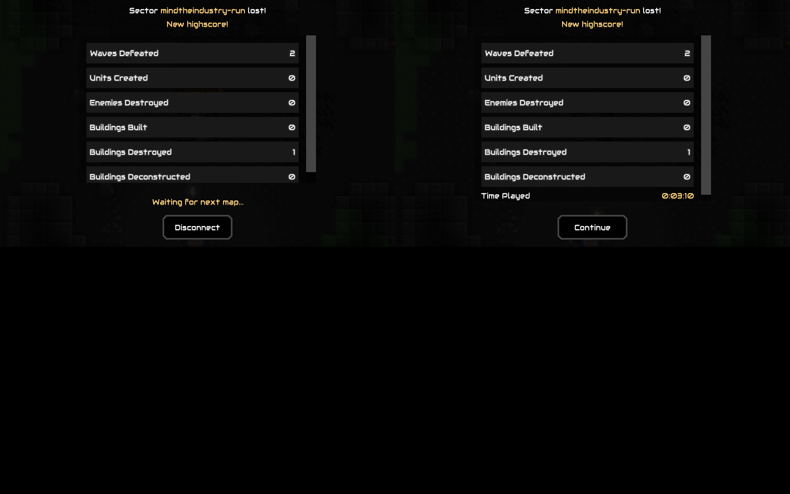
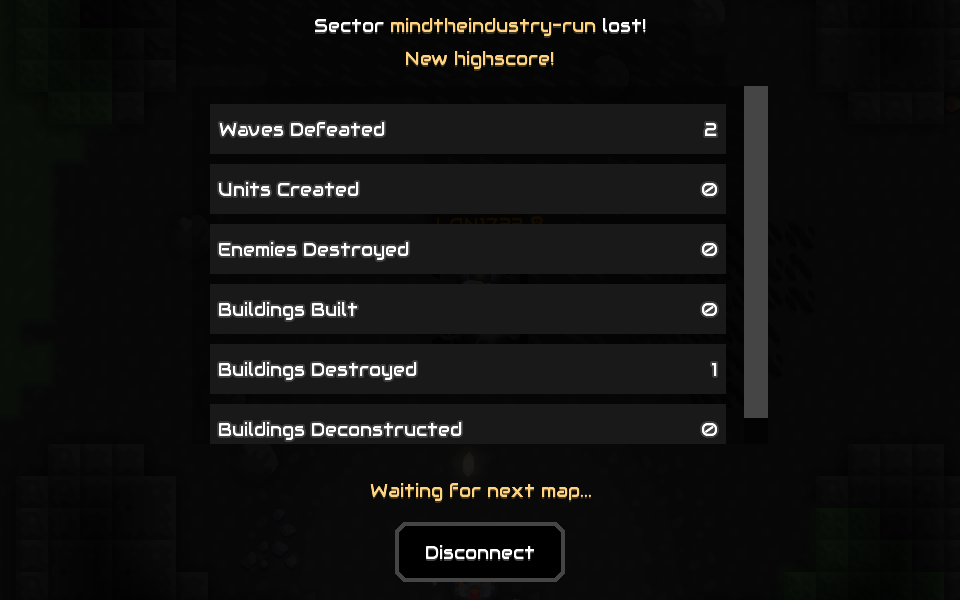
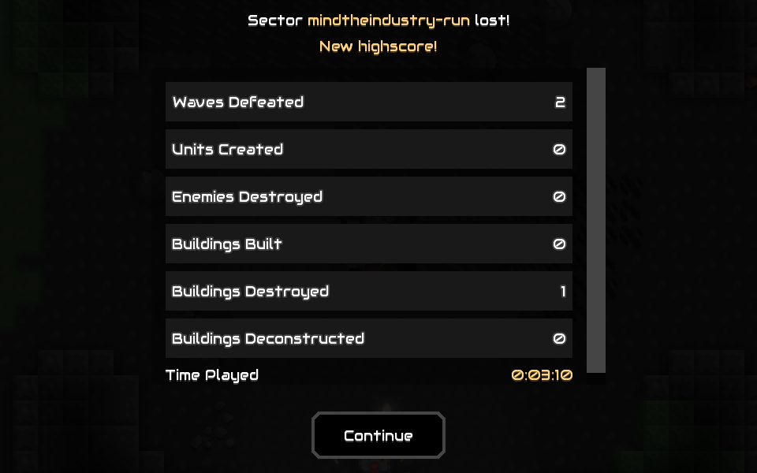

# LAN test evidence

Screenshots captured with `mise lan:proof <p1|p2|root> <name> <note>` while the
LAN stack was up, committed here so PRs/features can embed them. PNGs here are
tracked via **Git LFS** (`.gitattributes`: `tools/lan/evidence/*.png filter=lfs
...`), so install git-lfs (`git lfs install`) before pulling.

In PR bodies embed them with the absolute `blob/...?raw=true` URL (printed by
`lan:proof`) — relative links resolve against the base branch (broken until
merged) and `raw.githubusercontent.com` serves only the LFS pointer:

```md

```

Runtime shots stay gitignored in `tools/lan/shots/`; only curated proof shots
land here.

## lan-two-clients — 2026-11-02 (validated run)


Root screenshot with both LAN instances side by side (p1 at x=0, p2 at x=960), both in-game on the MTI run map after p1 hosted :6567 and p2 joined 127.0.0.1.

## p1-ingame-mti-run — 2026-11-02 (validated run)



p1 (host) in-game on mindtheindustry-run; mod server controller active.

## p2-ingame-mti-run — 2026-11-02 (validated run)



p2 (joined client) in-game on the same map after receiving world data.

## players-2 — 2026-11-02T20:52Z


player list on p1 (host) after p2 joined 127.0.0.1: shows 2 players

## players-2-client — 2026-11-02T20:52Z


player list on p2 (joined client): 2 players

## mti-mod-card-version — 2026-11-03T21:15Z


Mod card in the in-game Mods dialog: MindTheIndustry v0.1.0 [reward-pacing-and-boss-window 2fa7d86] — the git SHA baked into the build, matching PR head 2fa7d86

## mti-choice-box — 2026-11-03T21:16Z


In-game HUD after a wave ends: the choice box (top-center) offers the 3 proposals + take-none; the world keeps simulating (non-blocking)

## mti-two-clients — 2026-11-03T21:40Z


Two local instances on the private Xvfb: p1 (left, host :6567) in the MTI run, p2 (right) joined via 127.0.0.1 — '\''Bob has connected'\'' on the host, world data received on p2

## mti-p2-joined-run — 2026-11-03T21:40Z


p2 (Bob) joined p1'\''s hosted MTI run via 127.0.0.1: received world data, MTI map detected, run rules applied client-side
